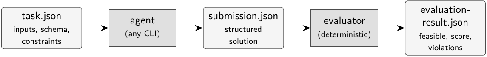

# Power Systems Agent Benchmark: Bringing Executable Evaluation to AI Agents on Electric Power Engineering Tasks

*Preprint draft v2 (2026-06). English version for arXiv (eess.SY; cs.AI).
Word-for-word Russian companion: `paper_ru_v2.md`. Annotated bibliography:
`bibliography.md`; BibTeX: `references.bib`.*

## Abstract

Executable evaluation — having an agent act and then checking the consequences of
that action with a program rather than grading its prose — has become a standard
way to assess tool-using AI agents in software and related settings. Electric
power engineering, by contrast, has barely begun to adopt agentic AI at all:
language-model use in the domain is still dominated by retrieval and text question
answering, agents that act on a power system exist only as a handful of academic
prototypes, and evaluation has correspondingly concerned the text a model produces
rather than the consequences of an action. We bring executable evaluation to
power-engineering agents. In the Power Systems Agent Benchmark an agent receives a
structured task and returns a structured solution; a deterministic evaluator then
recomputes the relevant engineering quantities, tests the operational constraints,
and returns a feasibility flag, a normalized score, and an explicit list of
violations. The benchmark spans 41 task families across eight areas of power
engineering — power flow and network analysis, short circuit and protection,
stability and grid-code compliance, distributed resources and storage, microgrid
dispatch, reliability and restoration, power quality and standards, and
forecasting — each grounded in a citable source and an engineering standard.
Beyond the public set, held-out cases are not distributed as data but synthesized
on demand by a per-family generator from a private seed, yielding a
contamination-resistant evaluation whose construction is open to inspection while
its instances remain private. Because the launch protocol is agent-agnostic, the
benchmark serves as a common platform for comparing language models and agent
harnesses and for studying agent behavior on physically grounded tasks; as a
reference evaluation we assess three command-line agents, which the benchmark
separates cleanly and on which public and held-out performance agree. The
evaluators are compact deterministic surrogates, and the task contract is designed
so that their internals can later be upgraded to simulator-backed checks without
changing how tasks are posed or solved.

## 1. Introduction

Large language models have, over a short period, moved from systems that produce
text to systems that take actions. Given access to tools, a model can read
structured data, call an external program, inspect the result, and decide what to
do next; wrapped in such a loop, it becomes what is now commonly called an agent.
This shift has been most visible in software, where agents resolve issues in real
code repositories, and in business operations, where they handle customer
workflows, query databases, and execute multi-step procedures through tool and
API calls. The appeal is the same across these settings: an agent can carry out
work that previously required a person to translate intent into a sequence of
tool invocations.

It is natural to ask whether the same capability transfers to specialized
engineering domains, where the work is governed not by conventions but by physical
law. Electric power systems are a demanding instance. Engineering decisions there —
estimating a fault current, choosing a protective relay setting, scheduling
generation under security constraints, screening a network for contingencies — rest
on circuit theory, on stability and protection principles, and on a dense body of
standards. Whether language-model agents can perform such work is an open research
question, and an active one: recent surveys document a rapid influx of agent and
LLM methods into power-system analysis [llmpowersurvey2025, agenticpowersurvey2025],
and early prototype systems have begun to appear [gridmind2025, xgridagent2025].
This activity is, for now, almost entirely experimental rather than deployed, which
makes the question of how to measure progress a pressing one in its own right.

Measuring it is harder than it first appears, because correctness in power
engineering is a physical property, not a textual one. A proposed relay setting can
be eloquently justified and fail to be selective; a dispatch can be internally
consistent and exceed a generator's limits; a restoration plan can read well and
de-energize the wrong feeder. Errors of this kind are invisible to a human skimming
the explanation and to a language model asked to judge it, because they are not
errors of expression — they are violations of network physics and operating limits,
and they surface only when the proposed solution is recomputed against the case.
The two evaluation methods most common in agent research are, for precisely this
reason, ill-suited here: question answering against a fixed reference answer cannot
accommodate the many admissible solutions an engineering task allows, and grading a
free-form report with a second model [zheng2023judging] rewards a fluent rationale
even when the underlying decision is unsound — a tendency reinforced by the
documented biases of such judges [wang2023fairevaluators].

In software and tool-use settings this difficulty has been met by executable
evaluation: an agent's output is not scored as prose but applied and checked by a
program. SWE-bench [jimenez2024swebench] runs a repository's own test suite against
the agent's patch; τ-bench [yao2024taubench] compares the final state of a database
against an annotated goal; terminal-bench [terminalbench2025] inspects the effect of
an agent's commands on a live shell. The
principle these share — judge the outcome of an action, not its description — is
exactly what power-engineering evaluation needs, and it has not been applied to the
domain at any breadth.

This paper does so. We introduce the Power Systems Agent Benchmark, in which each
task supplies an agent with structured inputs and a required output schema; the
agent returns a structured solution; and a deterministic evaluator recomputes the
relevant engineering quantities, tests the hard constraints, and returns a
feasibility flag, a normalized score in the unit interval, and an explicit list of
violations. The agent's natural-language explanation is recorded but excluded from
scoring. The public portion comprises 41 task families across eight areas of power
engineering, each grounded in a citable source and an engineering standard. The
held-out portion is not distributed as data: a generator produces held-out cases on
demand from a private seed, so that the construction of the held-out set is open to
inspection while its instances remain unknown to those being evaluated.

This benchmark is our primary contribution, and it is best understood as three
things at once. It is, first, a broad executable test of power-engineering
competence: 41 task families spanning eight areas of the field, each posed through a
uniform contract and checked by a deterministic evaluator that recomputes the
underlying physics, so that an agent is measured by what its decisions do rather
than by how it describes them. It is, second, a contamination-resistant evaluation:
rather than ship a fixed held-out set that ages and leaks, we provide a per-family
generator that synthesizes physically consistent, solvability-checked cases from a
private seed, keeping the held-out construction auditable while its instances stay
private. And it is, third, an agent-agnostic platform: because participating reduces
to reading a task file and writing a solution file, the same benchmark can compare
different language models and different agent harnesses under one protocol, and can
serve as a substrate for studying agent behavior on physically grounded tasks. We
accompany the benchmark with a reference evaluation of three command-line agents
and, in the course of running it, report a methodological observation — that a
failure shared by all agents is a reliable signal of a defective task or
evaluator — useful enough to recommend in its own right (Section 8.2).

## 2. Related Work

Our work draws on three lines of research, and is most easily located by where it
follows each and where it departs.

The first is executable evaluation of agents. SWE-bench [jimenez2024swebench] and
the earlier pass@k construction of Codex/HumanEval [chen2021codex] established that
an agent's output can be judged by executing it; τ-bench [yao2024taubench]
generalized this to tool-and-user interaction by comparing end states and proposed
pass^k as a reliability measure; terminal-bench [terminalbench2025] and MLE-bench
[chan2024mlebench] extend the idea to terminal work and machine-learning
engineering, while broad suites such as AgentBench [liu2024agentbench], GAIA
[mialon2023gaia], and WebArena [zhou2024webarena] probe general tool use. We adopt
this paradigm; our point of difference is coverage, since none of these targets
power-system engineering and its physical constraints.

The second line concerns *how* to score, and it is the reason we recompute rather
than judge. What ultimately matters is the effect of an agent's actions, not the
fluency of its account of them, and for verifying effects the strongest available
tool is a deterministic check. This is not a new idea — it is the basis of software
testing, and of competitive programming, where a submission is accepted only if it
passes a fixed suite of tests — and wherever a task admits such a check, as every
task in this benchmark does, it should be preferred: it is exact, reproducible, and
immune to the biases that attend a language-model judge, the biases of position,
length, and self-preference [zheng2023judging, wang2023fairevaluators] that are most
damaging exactly when a wrong answer is fluent. Model-based judging retains a role
where no deterministic check is feasible, and recent work extends it from single
responses to whole agent trajectories under the heading of *agent-as-a-judge*
[zhuge2024agentjudge, aisjudgeais2025]. We expect that as the benchmark grows to
include scenarios too open-ended for a closed-form evaluator, judging of this
kind — applied to actions and trajectories, not to prose — will become appropriate,
and we leave that path open; for the tasks presented here, deterministic
recomputation suffices, and the agent's rationale is kept only as a diagnostic.

The third line is domain-specific. Surveys [llmpowersurvey2025,
agenticpowersurvey2025] record a rapid growth of LLM and agent methods in power
systems with no settled means of evaluation. The closest effort to ours is
PowerAgentBench [poweragentbench], part of the actively developed PowerAgent
ecosystem at Harvard SEAS [zhang2025poweragent]. We adopt the same core design it
uses — a public/held-out split with an evaluator that recomputes physical validity —
which we do not claim as novel: PowerAgentBench is a prior instance of it in this
domain, and contamination-resistant held-out evaluation is by now a broadly
established idea [contaminationsurvey2025, white2024livebench]. ElecBench
[zhou2025elecbench] scores dispatch scenarios largely through text and judges, and
PFBench [pfbench2025] applies programmatic checking but only to power flow. The
prototype agents now appearing — GridMind [gridmind2025], X-GridAgent
[xgridagent2025], Grid-Mind CIA [gridmindcia2026], PFAgent [pfagent2026] — are the
intended subjects of a benchmark of this kind. What distinguishes our work is not
the split but its emphasis: breadth across many task families, held-out cases
generated from a seed rather than stored, and an explicit quality-control
procedure.

Two further bodies of work inform specific choices. Reinforcement-learning grid
environments, principally Grid2Op/L2RPN [marot2020l2rpn, marot2021retrospective],
provide a mature setting for sequential topology control and are built on
established power-system simulators — pandapower [thurner2018pandapower], MATPOWER
[zimmerman2011matpower], OpenDSS [dugan2011opendss], PowerModels/PGLib
[coffrin2018powermodels, babaeinejadsarookolaee2019pglib], ANDES [cui2021andes],
PyPSA [brown2018pypsa] — refined over many years to compute power-system physics. We
address the different problem of single-shot engineering decisions across many
subtasks under an agent-agnostic contract, and our current evaluators do not use
these simulators at all: each is a compact, self-contained deterministic check. We
name them only as the natural backend for higher-fidelity future versions of the
evaluators, not as a present dependency. Finally, the literature on benchmark
integrity informs the held-out split:
because training-data contamination inflates results [contaminationsurvey2025,
statictodynamic2025], dynamic and refreshed benchmarks have become the standard
response [kiela2021dynabench, white2024livebench, jain2024livecodebench], and a
seed-driven generator is a prevention mechanism of the same family. The runner
follows the prescriptions of [kapoor2024agentsmatter] on cost, reproducibility, and
the separation of failure classes, and respects the limits of best-of-N
characterized in [brown2024monkeys].

## 3. Design Requirements

The system is shaped by a small set of requirements, stated here at the outset
because most of what follows is a consequence of them; we note for each where it is
realized.

1. **Executable, physical verification.** A solution must be checked by running code
   rather than by matching strings, and that code must recompute the relevant
   physical quantities and test the operating constraints, not compare against stored
   text. The remaining requirements largely follow from this one (the contract is
   given in Section 4.1, the evaluators in Section 6).
2. **A leak-proof public/held-out split.** Public cases must support development and
   held-out cases a fair comparison; crucially, held-out answers must be excluded by
   construction rather than by policy, so that no amount of scrutiny of the released
   material reveals them (Section 4.4).
3. **Agent agnosticism.** Since the point is to compare models and harnesses on equal
   terms, launching an agent must not depend on any particular one — participation
   reduces to reading a task file and writing a solution file (Section 4.2).
4. **Provenance and machine-readable results.** Every task must declare where it
   comes from, with a confidence level (Section 5.1), and every result must be
   machine-readable — a feasibility flag, a score, and an explicit list of
   violations (Sections 4.1 and 6) — so that runs can be aggregated and audited
   without anyone reading prose.
5. **Room to grow.** The benchmark must be able to become more demanding without
   breaking compatibility, so that replacing a closed-form check with a
   simulator-backed one changes an evaluator's internals while leaving the task and
   solution formats untouched (Section 4.3).
6. **Specification-quality control.** Finally, because a benchmark's own tasks and
   evaluators can themselves be wrong, it must provide a means of telling a defect in
   its specifications apart from a genuine difference in agent capability
   (demonstrated in Section 8.2).

## 4. Architecture

### 4.1 Artifact contract

The benchmark is organized around a single linear contract (Figure 1): a task
description is given to an agent, the agent produces a structured solution, an
evaluator consumes the solution, and an evaluation result is emitted. A JSON schema
fixes each of the three artifacts. A task carries its identity and family, its public
inputs, the schema its solution must follow, the hard constraints that will be
checked, the metrics, the provenance, and a bilingual presentation block. A solution
carries the agent's structured answer and an optional rationale. An evaluation result
carries the feasibility flag, the score, the list of violations, and any supporting
evidence. Because the formats are fixed independently of how a task is solved or
checked, an agent and an evaluator need share nothing beyond these schemas.



A short-circuit task, abbreviated, illustrates the form:

```json
{
  "family": "three_phase_short_circuit",
  "public_inputs": {"short_circuit_case": {
    "base_mva": 100.0, "voltage_kv": 10.5,
    "voltage_factor_cmax": 1.1, "voltage_factor_cmin": 1.0,
    "positive_sequence_impedances_pu": [ /* ... */ ],
    "fault_resistance_pu": 0.005}},
  "submission_schema": {
    "ik_max_ka": "max initial symmetrical current (kA)",
    "ik_min_ka": "min current with fault resistance (kA)", "...": "..."},
  "hard_constraints": [
    "maximum current uses c_max over a bolted fault",
    "values match the independent positive-sequence calculation"],
  "metrics": [{"name": "feasible", "direction": "boolean", "...": "..."},
              {"name": "score", "direction": "maximize", "...": "..."}],
  "source_provenance": [{"title": "IEC 60909 short-circuit calculation",
                         "confidence": "high", "...": "..."}]
}
```

### 4.2 Agent-agnostic execution and a trustworthy runner

For a comparison across agents to be meaningful, the *runner* — the benchmark's own
apparatus that launches each agent (itself a harness of model, loop, and tools) on
each task and scores what it returns — must satisfy three properties beyond merely
invoking the agent. The first
is isolation: an agent must not be able to read the evaluator or any stored answer.
Each task is therefore packaged with its answer key and evaluator internals removed,
and is executed in a sandbox that has no path back to the benchmark's own code. This
matters because an agent with autonomous filesystem access can, in principle, reach
an evaluator that is within reach and grade itself against it; a written instruction
not to do so is no safeguard, since nothing compels the agent to honor it. Isolation
must therefore be structural rather than instructional.

The second property is robustness to malformed output. An agent may return a
solution that is syntactically valid but meaningless — null values, text where a
number is required, the wrong structure entirely — and the evaluator must treat this
as an ordinary failed solution, returning infeasible with a list of the offending
fields, rather than raising an exception that halts the entire run. Without this
property a single malformed solution can abort a multi-task evaluation partway and
leave an incomplete, incomparable record.

The third property is a principled separation of failure classes. A run can fail
for reasons that have nothing to do with the agent's competence — a transient
provider error, a dropped connection, an exhausted usage quota — and conflating
these with genuine failures contaminates the measurement. The runner classifies
each failure and retries only those attributable to infrastructure, never those in
which the agent produced a poor or absent solution within a healthy environment;
retrying the latter would silently turn the benchmark into a best-of-N search and
inflate every score. Each result records how many attempts it took and why earlier
attempts failed, and a run reports its metrics both with and without
infrastructure retries, so that provider reliability is never mistaken for agent
capability.

### 4.3 Evaluator maturity ladder

The evaluators are allowed to mature in place along a ladder: from a closed-form or
graph-based surrogate, through a deterministic engineering model, to a check backed
by a full power-system simulator, and ultimately to a stochastic or large-scale
scenario suite. The evaluators presented here occupy the first two rungs. The
contract of Section 4.1 is what makes the ladder usable: because the task and
solution formats are fixed independently of how a check is computed, the internal
step of replacing, say, a linearized power-flow surrogate with a full AC solution
upgrades an evaluator without altering anything an agent sees. The ladder describes
how a check is computed, but the contract is symmetric in the tools it admits:
nothing stops an agent, on its side, from invoking the same kind of software to
produce a solution — a possibility today's tasks do not yet exercise but later ones
will (Section 10).

### 4.4 The held-out split as a generator

The benchmark does not store its held-out cases at all. In place of held-out data
files, it provides a generator: a collection of deterministic, physics-aware
perturbations, one per family. A held-out case is produced from a public case by
redrawing its numerical content — network parameters, weather series, load
profiles, a fault location together with the indicator readings and customer
complaints it implies — under a private random seed, and a draw is accepted only if
the family's reference solver still solves it, the evaluator confirms the solution
feasible, and no small perturbation of that solution scores higher — keeping the
reference solution the optimum against which the case is scored (Section 6) — with a
deterministic redraw otherwise. Whoever operates a
leaderboard keeps the seed private; anyone else can read exactly how held-out cases
are constructed without learning the particular instances of any round. This makes
the held-out set, normally the most leak-prone component of a benchmark, auditable
in mechanism and private in content at the same time. The same discipline extends to
the records of evaluation runs: an agent's solution to a held-out case, and the
evaluator's per-case output, each disclose that case's answer, so only aggregate run
summaries are published — never the per-case held-out submissions, results, or logs.

## 5. Task Set

The public benchmark comprises 41 task families, grouped into eight domain areas:

1. **Network analysis and operating constraints** — bus-admittance-matrix
   construction, corrective reactive-power dispatch for voltage limits, contingency
   screening, post-contingency corrective switching, dynamic line rating.
2. **Short circuit and protection** — three-phase and single-line-to-ground fault
   calculation, breaker and relay setting from fault levels, distance-protection zone
   setting, overcurrent coordination, cable sizing.
3. **Stability, grid code, and inverter-based resources** — critical clearing time by
   the equal-area criterion, transient-stability classification, fault-ride-through
   compliance, current-limited inverter fault response, minimum synchronous-generation
   share under inertia and short-circuit constraints.
4. **Distributed resources, PV, EV, and storage** — Volt-VAR control, vehicle-to-grid
   scheduling and voltage support, battery ancillary-service response, soft-cost
   levelized-cost calculation.
5. **Microgrids and dispatch** — economic and rolling-horizon dispatch, islanded
   active/reactive dispatch, robust dispatch under uncertainty, hydro-thermal unit
   commitment, single-contingency-secure generation commitment.
6. **Reliability and restoration** — fault isolation and service restoration,
   faulted-section localization, fault-indicator placement, reliability-index
   improvement, operator switching and shedding.
7. **Power quality, standards, assets, and cybersecurity** — voltage-compliance
   checking to a supply standard, power-quality event classification, harmonic-limit
   compliance, transformer thermal loading and insulation ageing, bad-data
   identification in state estimation, secured-measurement placement, lead-station
   handover in a multi-agent frequency scheme.
8. **Forecasting under uncertainty** — wind power forecasting, prediction-interval
   estimation.

Each task was checked for physical correctness against its cited source before
inclusion. Every family carries a documented source and confidence level
(Section 5.1), and the appendix lists the full catalog with identifiers.

### 5.1 Provenance and confidence

Because the task set is drawn from the engineering literature rather than authored
from scratch, each family records where its formulation comes from and how firmly it
is tied to that origin. Every task carries a
provenance entry — a source title, a locator (a digital object identifier or URL for
an article, a clause for a standard, or a full citation for a textbook), and a short
note on how the source maps onto the executable case — together with a stated
confidence level. The confidence level is a deliberate, declared judgment rather than
a measured quantity, and we assign it by a fixed rubric so that it is reproducible:

- **high** — the task reproduces a method defined in a published standard or a
  canonical textbook, cited specifically, and the executable case follows that method
  directly (for example, the short-circuit, transformer-loading, and
  harmonic-compliance tasks follow named international standards, and the
  critical-clearing-time and bad-data tasks follow standard textbook procedures);
- **medium** — the task is tied to an identified primary source, or to a universally
  taught engineering method written out as its governing equations, and the case is a
  faithful compact instance of it;
- **low** — no single primary document is pinned: the method is standard but the
  task is an adaptation in its spirit rather than a reproduction of a specific source.

Under this rubric, of the 41 families 11 are rated high, 28 medium, and 2 low; the
two low cases (uncertainty-aware dispatch and minimum synchronous share) keep that
rating because no single source we could verify fully grounds their exact
formulation, and we prefer to say so than to inflate the label. We regard the scheme
as a floor on transparency rather than a guarantee of fidelity: it lets a reader
trace any task to its origin and see at a glance how tightly it is bound there, and
it makes explicit which tasks are faithful renderings of a standard and which are
looser adaptations of common practice.

## 6. Evaluators and Metrics

Every evaluation returns the same four things: a feasibility flag, a score in the
unit interval, a list of violations stated in words, and task-specific evidence. The
two numbers play distinct roles. Each task declares a set of *hard constraints* — the
physical and operational requirements a solution must satisfy to be admissible at
all, such as respecting a generator's limits, holding every voltage within its band,
or keeping the network radial — and a solution is *feasible* only if it violates none
of them. The score then grades quality among feasible solutions; an infeasible
solution scores zero however close it may have looked.

How the score is computed depends on the task, but every score is reported *relative
to the reference optimum*: it is scaled so that an optimal solution earns exactly one,
and a feasible but worse solution earns a fraction below it. This matters because many
tasks have no natural unit ceiling on their raw objective — a reactive effort in kvar,
a switching cost, an amount of restored load — so without this scaling even a perfect
answer would score below one. The reference solver for each family computes that
optimum and is optimal by construction; an agent's solution, being one feasible
solution among many, cannot exceed it, and should a submission nonetheless score
higher the reference was not optimal on that case and the reported score is capped at
one. An exact computation is scored against numeric tolerances; a control or
optimization task scores the gap between the submitted objective and the optimum, so
that an alternative optimum of equal cost receives full credit and a feasible but
costlier solution receives partial credit; a classification or localization task is
scored against exact sets with enumerated misses; and a standards-compliance task as
pass/fail with diagnostic fields.

A microgrid dispatch task makes the distinction concrete: its hard constraints are
the power balance, the generator and battery limits, and the state-of-charge bounds;
any schedule meeting all of them is feasible, and among feasible schedules the
least-cost schedule scores exactly one while a costlier feasible dispatch scores below
one in proportion to its cost gap.

At the level of a whole run we report two aggregates that need not agree: the
*feasible rate*, the fraction of tasks whose solution satisfied every hard
constraint, and the *perfect rate*, the fraction scoring exactly one (feasible and,
where graded, optimal). The two diverge whenever an agent produces admissible but
suboptimal solutions, and because they can rank agents differently we report both
alongside the mean score.

## 7. Reproducibility

Every number in this paper can be regenerated from the repository. A single command
runs the unit tests over the evaluators, the reference solvers, the runner, and the
generator; validates every artifact; evaluates each of the 41 public sample solutions
individually; and runs the reference solvers across the public set, which return all
41 cases feasible. Because each task's score is measured relative to its own reference
optimum (Section 6), a reference solution scores one by construction, so the check
confirms not that the tasks are easy but that every task has a contract-valid,
physically consistent reference solution. One limit of such a check is worth stating
plainly: a reference solver and an evaluator built on the same kernels can share the
same mistake and still agree, so their agreement confirms the contract but cannot, by
itself, certify the evaluator's underlying physics. Continuous integration runs the
full check on every change.

## 8. Experiments

We evaluated three command-line agents on an identical task input — the same
`task.json` and the same instruction file for every agent on every task — under a
fixed per-task timeout and the infrastructure-retry policy of Section 4.2, with no
adaptation of the agents to the benchmark. Each agent was invoked through its own
command-line interface and ran under whatever internal system prompt and
scaffolding it ships with; we standardize what the task asks, not how an agent
organizes itself to answer it, since that scaffolding is part of what an agent is
and what the benchmark compares. The three are Codex running gpt-5.5 at medium
reasoning effort, Cursor's command-line agent running composer-2.5, and the
open-source OpenCode agent running deepseek-v4-flash; we refer to them below as
codex, cursor, and opencode.

### 8.1 Public versus held-out evaluation

The reference round was run after the corrections described in this paper. Each agent
attempted the public case of every family and one freshly generated held-out case
per family drawn from a new private seed. No run triggered the retry policy of
Section 4.2, so the figures below are reported directly.

| agent | public feasible | public perfect | public mean | held-out feasible | held-out perfect | held-out mean |
|---|---|---|---|---|---|---|
| codex | 40/41 | 36/41 | 0.971 | 40/41 | 37/41 | 0.969 |
| cursor | 39/41 | 35/41 | 0.947 | 40/41 | 36/41 | 0.969 |
| opencode | 37/41 | 35/41 | 0.900 | 38/41 | 35/41 | 0.920 |

Two observations follow. The benchmark discriminates between agents: codex and
cursor, both near a mean of 0.97, sit clearly above opencode at 0.90 to 0.92, and do
so on both splits. And, on corrected specifications, the public and held-out splits
are comparable — each agent's held-out score lands within noise of its public one. We
report this plainly because an earlier round, run before the specification
corrections, had appeared to show a sharp divergence in which the public leader
collapsed on held-out cases. That divergence proved to be an artifact of the defects
discussed next, which happened to fall hardest on one agent; it vanished once the
defects were corrected. We therefore make no claim of an intrinsic difficulty gap
between public and held-out cases. The case for a held-out split is instead
prospective: a published set ages as models train on it, and a generator is what
keeps an uncontaminated draw available. As mild corroboration, the agents do not
score higher on the published public set than on freshly generated held-out cases —
the signature one would expect from memorization is absent at this case size.

### 8.2 Distinguishing capability from specification

Reading the failures across agents rather than per agent proved the most useful
analysis available, because the failures separate into two kinds. When agents fail a
task in different ways — one breaching a voltage limit where the others hold it, one
returning a wrong ride-through verdict, one inverting a sign — the disagreement is
signal, and it is what a leaderboard should reward. But when every agent fails a task
in the same way, the more likely explanation is that the task, not the agents, is at
fault. Treating that pattern as a diagnostic surfaced ten defects in the
specifications: a field whose description contradicted its name, so that two agents
correctly computed a fraction where the evaluator expected a percentage; nested keys
that did not match the checker; a semantically empty zero entry that was nonetheless
rejected; a demand for an exact match to one of several optima of equal cost;
unstated conventions for a power curve, for quantiles, and for the terms of a heat
balance; a hardcoded dispatch policy; and an underspecified scoring formula. Each
correction was confirmed by re-evaluating the affected family and observing the
agents recover. We propose the underlying rule — a unanimous failure should be
suspected as a defect in the specification or the evaluator — as a routine
quality-control step for executable benchmarks.

The most consequential instance pointed not at a task but at an evaluator, and is
worth stating in full, as it is the clearest evidence we have for the value of the
method. On one held-out reliability case concerning faulted-section localization, all
three agents identified the same faulted section, a conclusion consistent both with
the fault-current-indicator readings and with the pattern of customer complaints; the
evaluator demanded a different section that in fact contradicted the case's own
indicator readings. The agents were correct and the evaluator was wrong. The cause was
an off-by-one error in the evaluator's indicator model: it had placed the faulted
section's downstream node on the fault-current path, so that an indicator at that node
was predicted to register a fault current it would not in fact see, whereas an
indicator registers fault current only when the fault lies strictly downstream of it.
What makes this more than a corrected bug is that the benchmark's own safeguards could
not have caught it. The reference solver used for self-checking is derived from the
same function as the evaluator, so solver and evaluator agreed with each other and the
public sample passed; the error was invisible from within and became visible only
because three independent agents brought the correct physics to bear. An executable
benchmark, in other words, can harbor a latent domain error in the very code that
defines correctness, and a matrix of agents is a means of finding it — a caution we
would extend to any benchmark whose reference answers are derived from its evaluator.

## 9. Limitations

Several limitations bound what these results support. The public cases are compact —
networks of a few buses and short time series — so they test whether an agent commands
a method, not whether it scales to industrial data volumes. The evaluators are
deterministic surrogates, and no claim of industrial AC accuracy is warranted until
simulator-backed checkers are in place. With one case per family per split, a ranking
over 41 points is statistically fragile, though the generator makes enlarging the
sample inexpensive. The tasks are also self-contained: an agent computes each answer
directly and is never required to operate professional power-system software, so the
benchmark does not yet measure mastery of the simulators and tools that much real
engineering work depends on. The reference solver's perfect public score is a
self-consistency
check on the contract, not a lower bound on difficulty, and cannot validate the
evaluator. The seed of a held-out round is spent once the round is disclosed, so a
citable leaderboard requires a fresh seed on an isolated host. The sandbox isolates by
relocation rather than containerization, which removes leakage through relative paths
and environment but not a determined search for the evaluator by absolute path, so
competitive use would want host-level containers. We run one configuration per agent
and so do not estimate the variance of model sampling. Finally, evaluating an agent
built on the same model family as the benchmark's authors, on an account whose budget
is shared with development, proved infeasible because it exhausted that budget; a
clean self-evaluation would require a dedicated account and an explicit
conflict-of-interest statement.

## 10. Conclusion

We have brought executable evaluation, by now standard for software and tool-use
agents, to electric power engineering, where assessment had remained textual. The
benchmark turns power-system tasks into checks that recompute physics, and on a matrix
of current agents it discriminates between them consistently across its public and
held-out splits. Its most transferable contribution is not any single task but a
method: reading a unanimous failure as a defect signal, which over the course of this
work uncovered ten specification defects and a latent error in an evaluator's physics
that the benchmark could not have caught by self-consistency alone — a reminder that a
reference answer derived from an evaluator cannot certify it. The lasting value of the
artifact lies in the contract, the domain-grounded task set, the evaluators, the
seed-driven held-out generator with its prospective resistance to contamination, the
isolated runner, and the reproducible quality-control procedure; one line of work
ahead is to fill the evaluators with simulator-backed implementations without
disturbing the contract that holds them together.

A second axis of growth concerns the agent rather than the evaluator. The tasks
presented here are self-contained: an agent reads a case and computes an answer, and
while it may write and run scratch code, no task yet requires it to operate
professional power-system software. Yet much of real engineering work is exactly
that — driving a load-flow package, a short-circuit tool, or a dynamic simulator — and
the production agents now emerging in the domain already orchestrate such tools. The
contract imposes no limit here: an agent is free to invoke whatever tools its sandbox
provides to produce a solution. A natural next generation of tasks would therefore
measure not closed-form competence but mastery of these specialized environments, with
the simulator serving as the agent's instrument rather than the evaluator's. The
duality is worth naming: the same simulator can sit on either side of the contract —
the agent's tool for solving, or the evaluator's backend for checking — and the
isolation of Section 4.2 is exactly what must keep the two apart, so that an agent can
never reach the checking instance as an oracle.

## Appendix A. Task Catalog

The full catalog of 41 families, in English and Russian, with identifiers, is provided
with the benchmark.

## Appendix B. Experiment Artifacts

The per-agent, per-split summaries and logs of the reference round, the earlier
development rounds, and the record of specification corrections are provided with the
benchmark.
